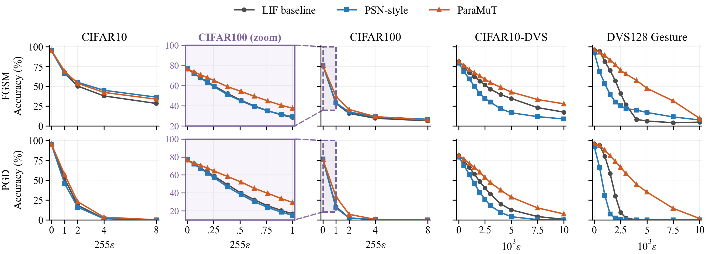

# ParaMuT: Parallel Multi-Timestep Neurons for Fast, Robust, and Hardware-Efficient Spiking Neural Networks

ParaMuT processes a block of consecutive timesteps together and carries the membrane state into the next block. A learned lower-triangular matrix mixes inputs within the block, so a spike can depend only on inputs up to that timestep. The VGG comparison pairs ParaMuT with a leaky integrate-and-fire (LIF) neuron that updates after each step and a PSN-style neuron that mixes the entire sequence with a learned full matrix and a fixed threshold.

| Dataset | Model | Experiment guide |
| --- | --- | --- |
| CIFAR-10 and CIFAR-100 | Spiking VGG11-BN | [Training and robustness](docs/experiments/vision.md#vgg11-bn) |
| CIFAR10-DVS and DVS128 Gesture | Spiking VGG11-BN | [Event frames and robustness](docs/experiments/vision.md) |
| CIFAR-10 and CIFAR10-DVS | Spikformer v1 | [Spikformer recipes](docs/experiments/vision.md#spikformer-v1) |
| Spiking Heidelberg Digits (SHD) | Delayed and zero-delay networks for LIF and ParaMuT, with a separate SpArch PSN-style experiment | [SHD data and experiments](docs/experiments/sequence.md#spiking-heidelberg-digits) |
| UCI HAR | SpikeCNN-BN with LIF, ParaMuT, and PSN-style neurons | [UCI HAR data and experiments](docs/experiments/sequence.md#uci-human-activity-recognition) |

The neuron models, data loaders, and robustness evaluators live in [`paramut/`](paramut/). Figures for the paper and this README live in [`docs/figures/`](docs/figures/).

## Environment

The experiments used Python 3.10, PyTorch 2.5.1, and torchvision 0.20.1 on Linux. For a CUDA 12.1 environment, run the following commands from the repository root. For a Linux CPU environment, change `cu121` to `cpu` in the wheel index URL. Other platform-specific commands are available in the [PyTorch installation archive](https://pytorch.org/get-started/previous-versions/#v251).

```bash
python3.10 -m venv .venv
source .venv/bin/activate
python -m pip install --upgrade pip
python -m pip install torch==2.5.1 torchvision==0.20.1 --index-url https://download.pytorch.org/whl/cu121
python -m pip install -r requirements.txt
```

SpikingJelly supplies the neuron and event-data primitives, timm supplies the Spikformer training utilities, and the SHD pipeline uses h5py and DCLS. The versions are pinned in [requirements.txt](requirements.txt).

## Train and evaluate

For a complete CIFAR-10 ParaMuT run, train a model and pass its selected checkpoint to the robustness evaluator. The first command downloads CIFAR-10 into the local data directory.

```bash
python run_vision.py train --dataset cifar10 --method paramut \
    --data-dir data/cifar10 --download --output-dir outputs/cifar10/paramut
python run_vision.py evaluate --checkpoint outputs/cifar10/paramut/model.pt \
    --data-dir data/cifar10
```

Use `--method lif` or `--method psn` with a separate output directory to train the VGG baselines. The guides give the dataset layouts, checkpoint policies, and corresponding commands for the other experiments. [Vision guide](docs/experiments/vision.md) · [SHD and UCI HAR guide](docs/experiments/sequence.md)

## Results

On DVS128 Gesture, VGG11-BN reached 96.18% clean accuracy with both LIF and ParaMuT. Under seven-step projected gradient descent (PGD-7) at a perturbation budget of 0.005 on normalized event frames, accuracy was 0.00% for LIF, 0.00% for PSN-style, and 35.07% for ParaMuT. These are single-seed measurements. See the [results and evaluation protocols](results/README.md).



The horizontal axis shows the perturbation budget in pixel or normalized event-frame units, scaled as labeled. The CIFAR-100 inset uses a separate, finer evaluation grid. The downloadable tables cover the six datasets and include per-seed accuracy, area under the attack curves, and measurements at each budget. [Summary CSV](results/summary.csv) · [FGSM and PGD curves](results/curves.csv) · [Event corruptions](results/event_corruptions.csv)

## Citation

If you use the code or results in your work, please cite the [ParaMuT software repository](https://github.com/superstarghy/ParaMuT).

```bibtex
@misc{paramut,
  author       = {Hanyuan Gao and Xiaoxuan Yang},
  title        = {{ParaMuT}: Parallel Multi-Timestep Neurons for Fast, Robust, and Hardware-Efficient Spiking Neural Networks},
  year         = {2026},
  howpublished = {GitHub software repository},
  url          = {https://github.com/superstarghy/ParaMuT}
}
```

## Licensing and attribution

The project's original source code and scripts are licensed under the [MIT License](LICENSE).

The original documentation, figures, and experiment result compilations (including this README, its charts, and the CSVs in `results/`) are licensed under CC BY 4.0 unless otherwise credited. When sharing them, credit Hanyuan Gao and Xiaoxuan Yang, link to the source and license, and indicate any changes. [CC BY 4.0 summary](https://creativecommons.org/licenses/by/4.0/) · [Full license text](licenses/CC-BY-4.0.txt)

Portions adapted from Spikformer and SpArch carry their upstream MIT and BSD-3-Clause notices. External datasets and software dependencies are subject to their own terms. [Spikformer notice](paramut/torch_spikformer_v1.py) · [SpArch notice](licenses/SpArch-BSD-3-Clause.txt) · [SpikingJelly license](https://github.com/fangwei123456/spikingjelly/blob/0.0.0.0.14/LICENSE)
